# 快速部署

欢迎使用 Firekylin，只需要几个步骤，你就可以开启你的博客之路。

## 部署服务端

1. 点击上方按钮，跳转至 Vercel 进行 Server 端部署。

   ::: note

   如果你未登录的话，Vercel 会让你注册或登录，请使用 GitHub 账户进行快捷登录。
   
   :::

1. 输入一个你喜欢的 Vercel 项目名称并点击 `Create` 继续:

   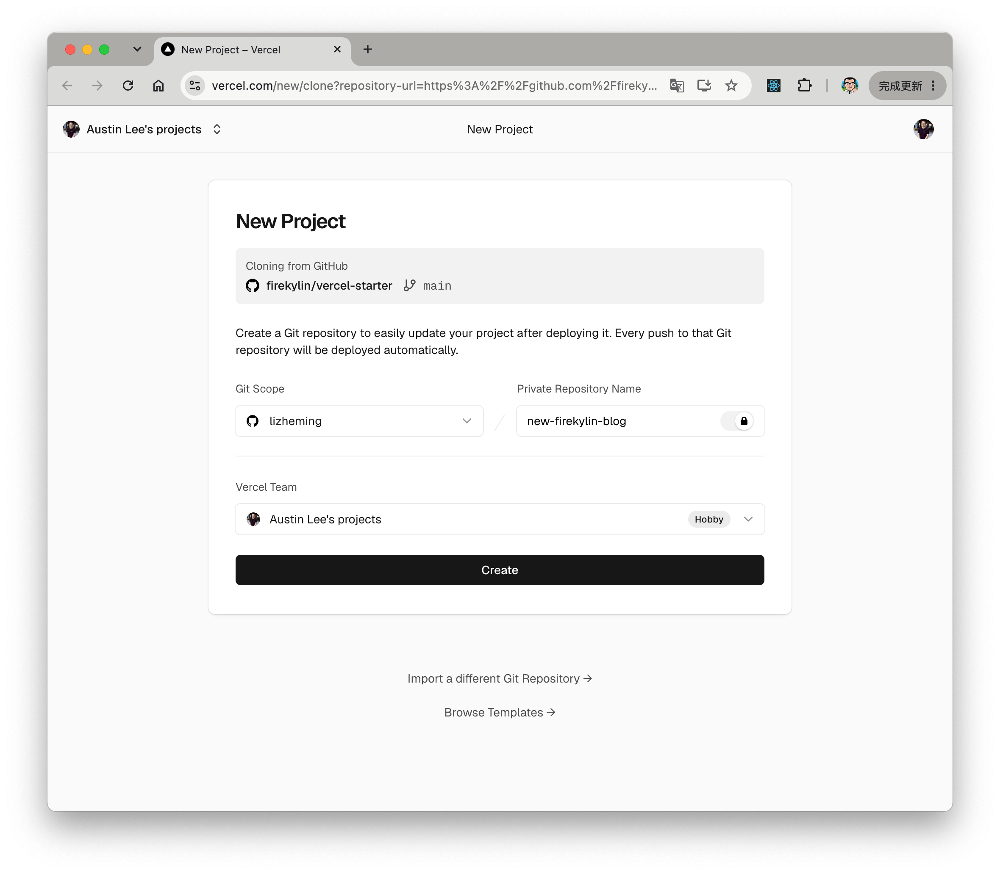

1. 此时 Vercel 会基于 Firekylin 模板帮助你新建并初始化仓库，仓库名为你之前输入的项目名。

   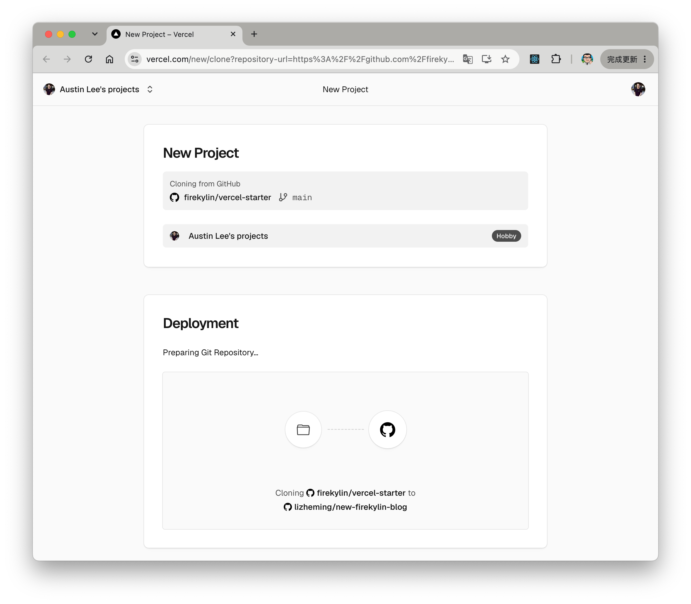

  一两分钟后，满屏的烟花会庆祝你部署成功。此时点击 `Continue to Project` 可以跳转到应用的控制台。

   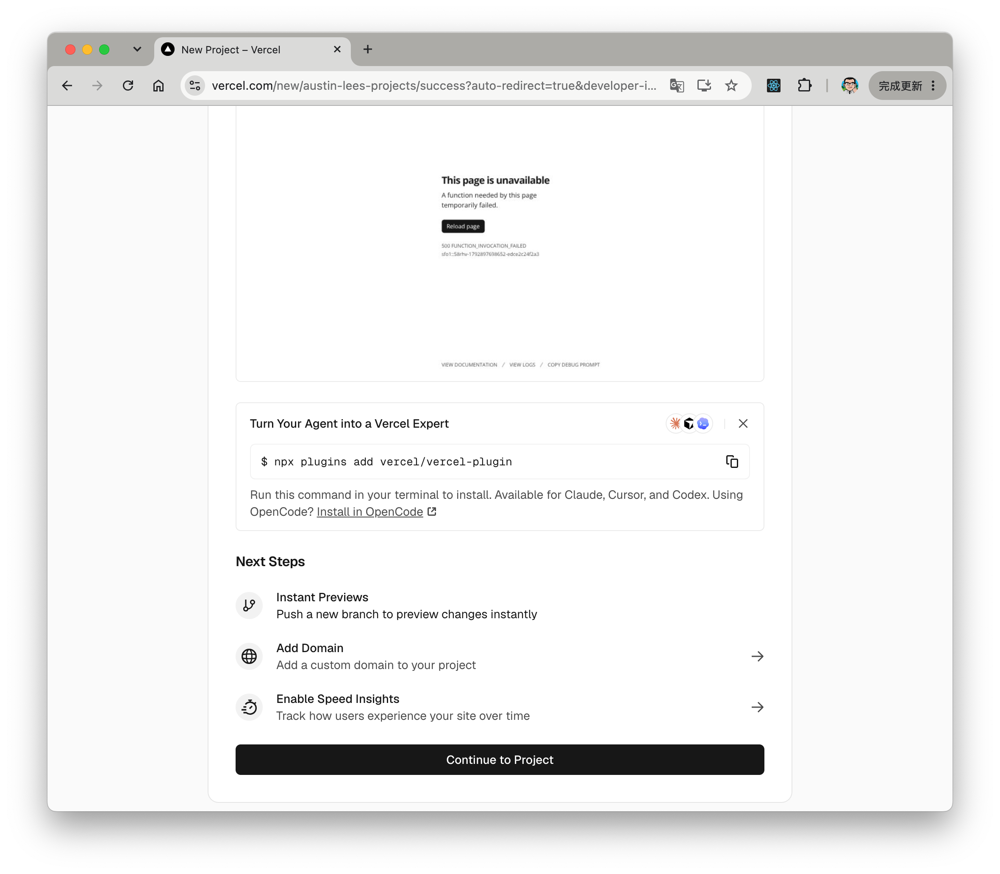

## 创建数据库

1. 点击顶部的 `Storage` 进入存储服务配置页，选择 `Create Database` 创建数据库。`Marketplace Database Providers` 数据库服务选择 `Neon`，点击 `Continue` 进行下一步。

   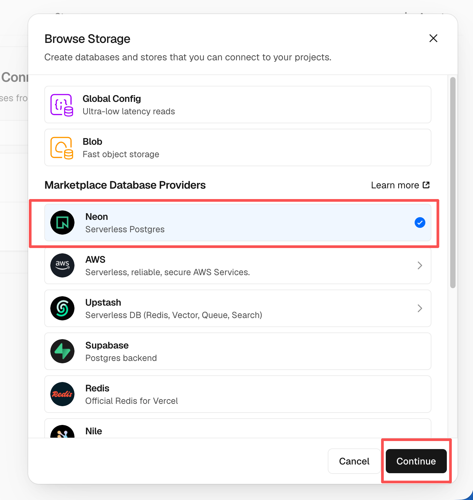

1. 此时会让你创建一个 Neno 账号，此时选择 `Accept and Create` 接受并创建。后续选择数据库的套餐配置，包括地区和额度。这里可以什么都不操作直接选择 `Continue` 下一步。

   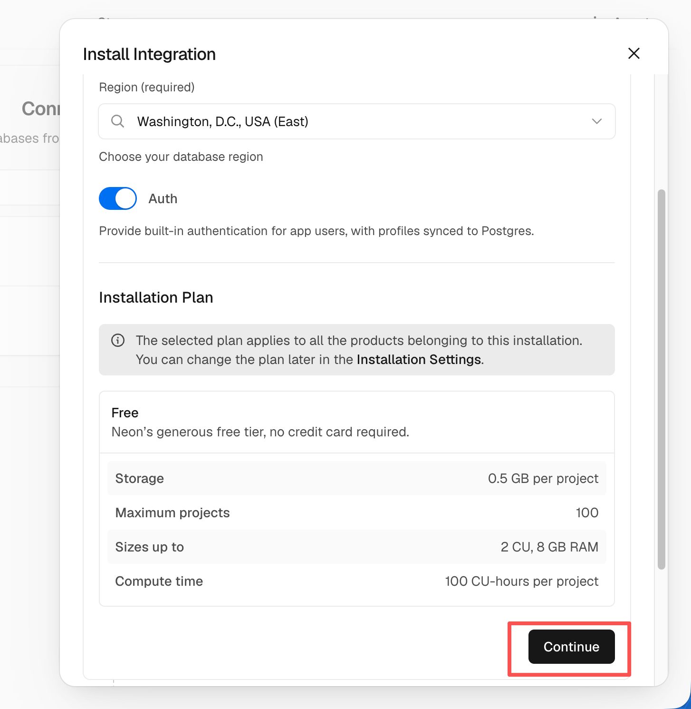

1. 此时会让你定义数据库名称，这里也可以不用修改直接 `Continue` 进行下一步。

   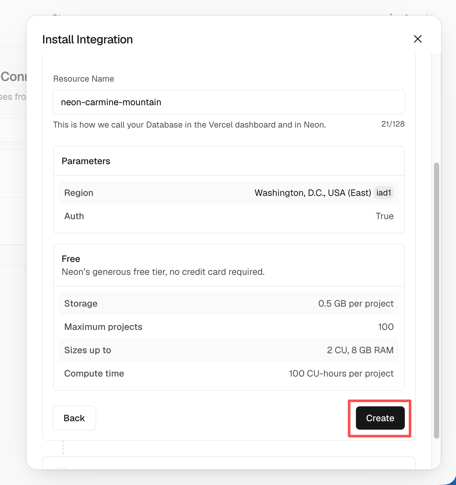

   这时候 `Storage` 下就有你创建的数据库服务了

1. 此时回到 Vercel，点击顶部的 `Deployments` 点击顶部最新的一次部署右侧的 `Redeploy` 按钮进行重新部署。该步骤是为了让刚才配置的数据库服务生效。

   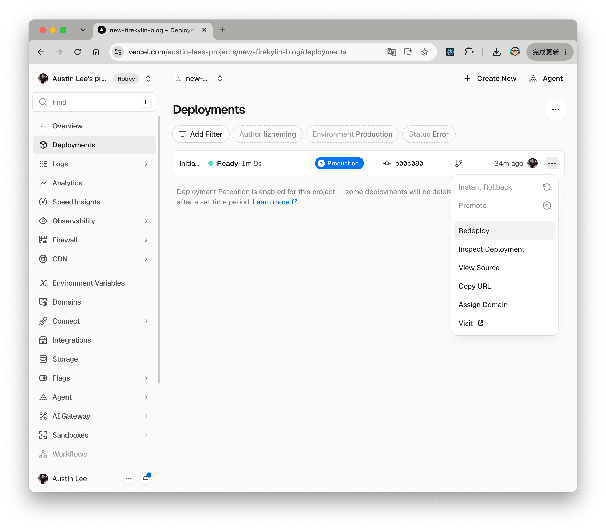

1. 此时会跳转到 `Overview` 界面开始部署，等待片刻后 `STATUS` 会变成 `Ready`。

## 绑定域名

1. 点击顶部的 `Settings` - `Domains` 进入域名配置页

2. 输入需要绑定的域名并点击 `Add`

   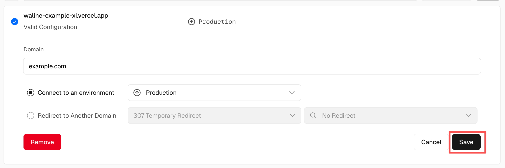

3. 在域名服务器商处添加新的 `CNAME` 解析记录

   | Type  | Name    | Value                |
   | ----- | ------- | -------------------- |
   | CNAME | example | cname.vercel-dns.com |

4. 等待生效，你可以通过自己的域名来访问了:tada:
   - 博客首页：example.yourdomain.com
   - 博客后台：example.yourdomain.com/admin

## 最后一步

1. 万事俱备，只欠东风。这时候我们访问博客首页地址 https://example.yourdoman.com。跳转过去之后，会进入系统初始化界面。
   
   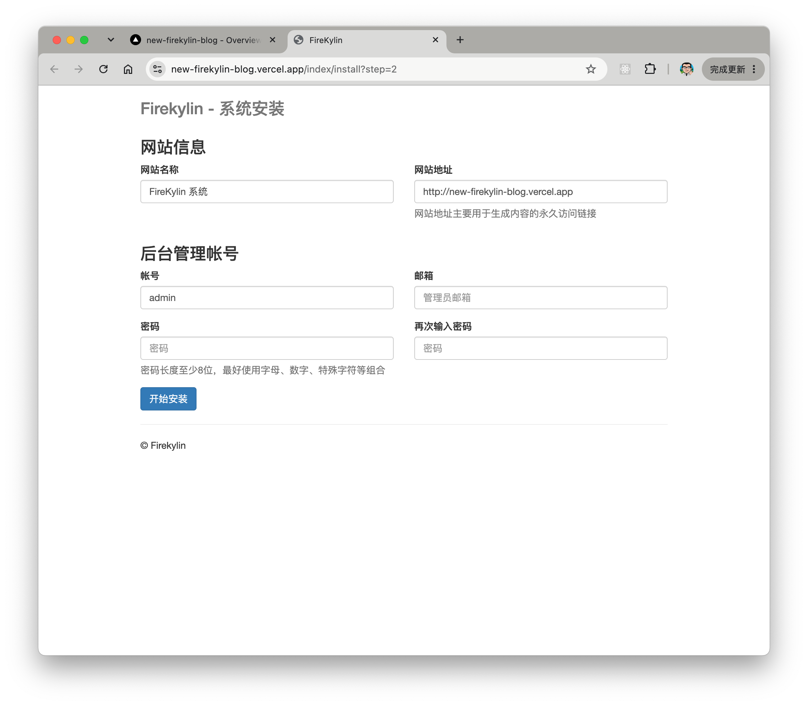

1. 设置好网站的标题、地址、管理员的账号、邮箱、密码。点击开始安装后即可完成安装。

   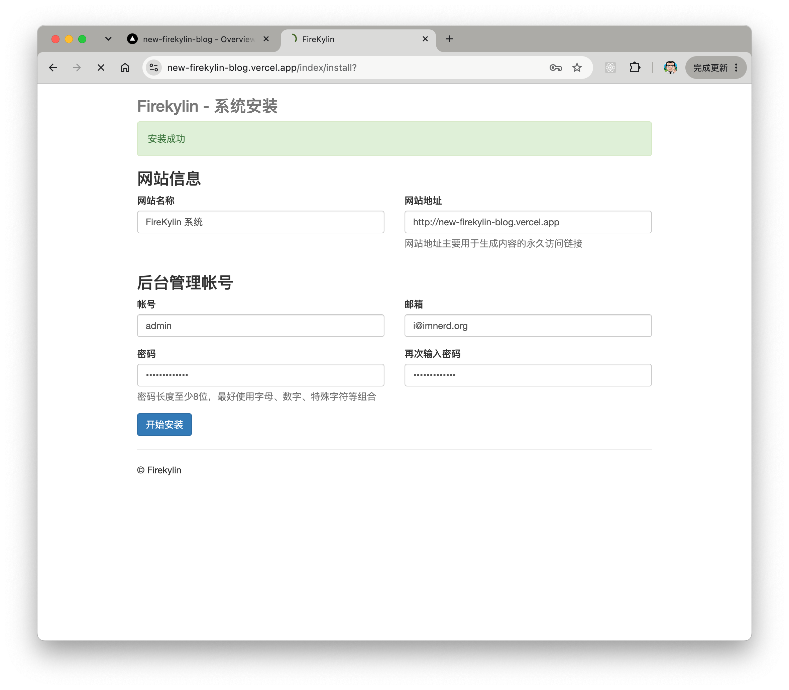

至此整个网站的安装就全部完成，恭喜你可以开始尽情开始创作啦！

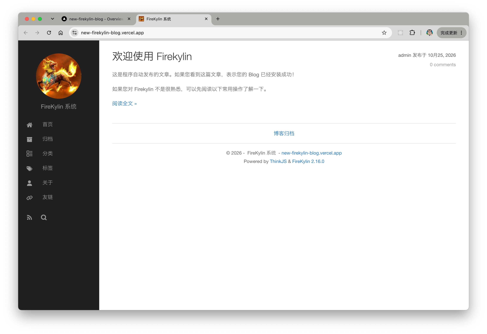

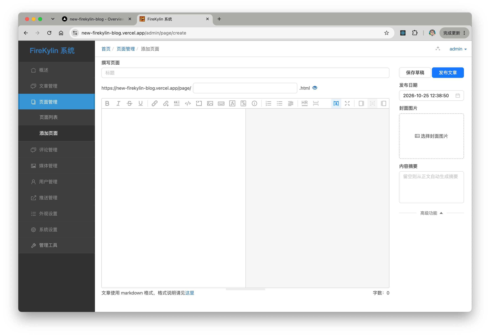

::: warning

1. Vercel 的本地文件系统不适合持久化数据，请使用外部数据库；需要持久保存上传文件时，请配置对象存储。
2. 如果需要在本地或自己的服务器上运行，请参阅[本地部署](本地部署.md)。

:::